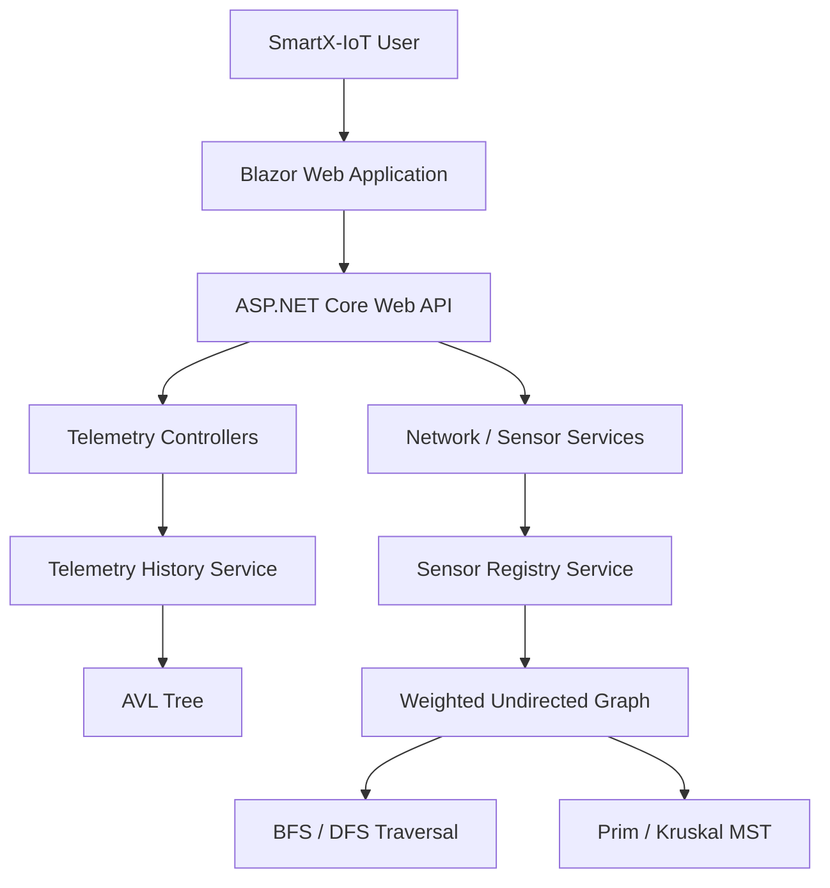
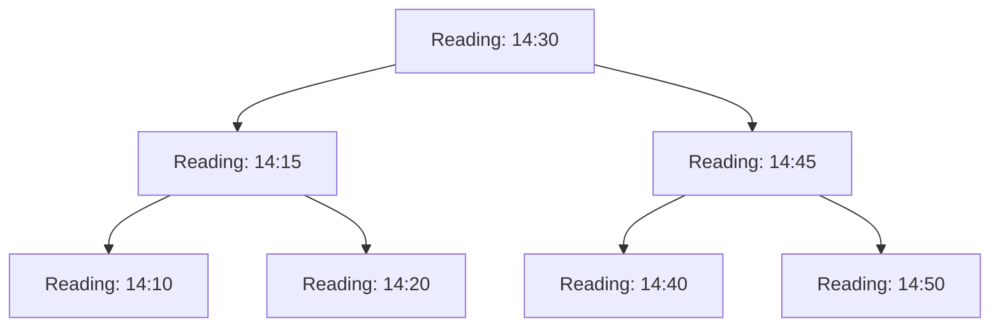
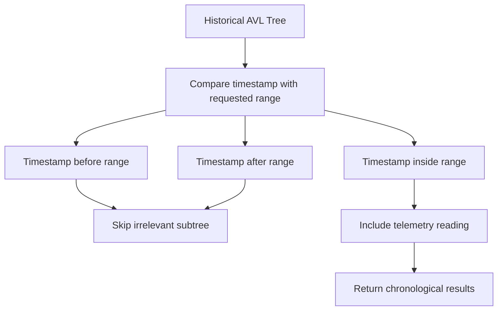
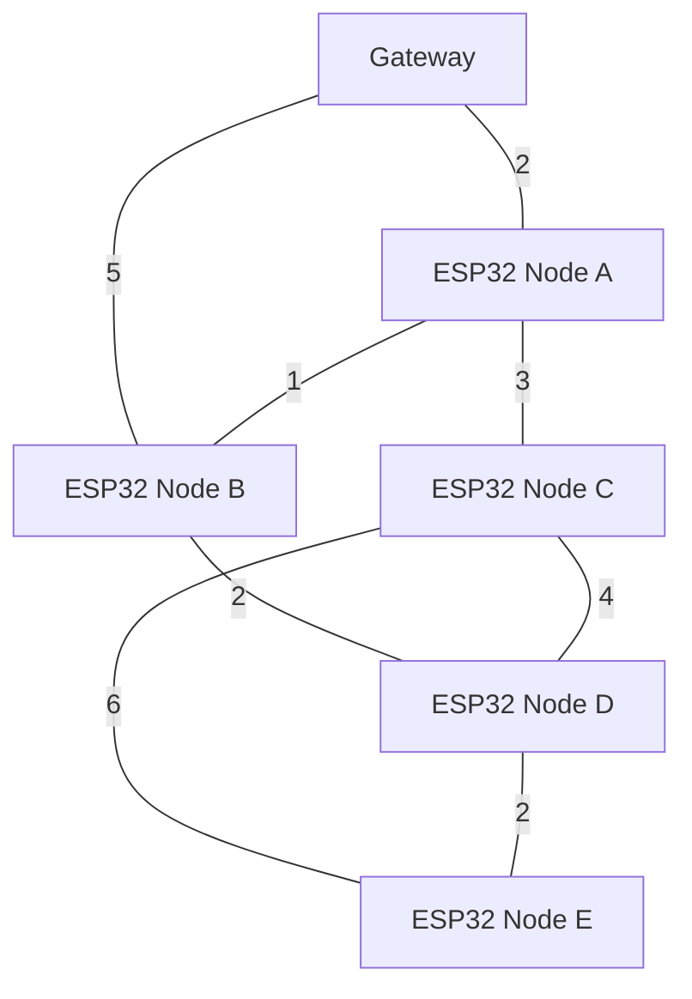
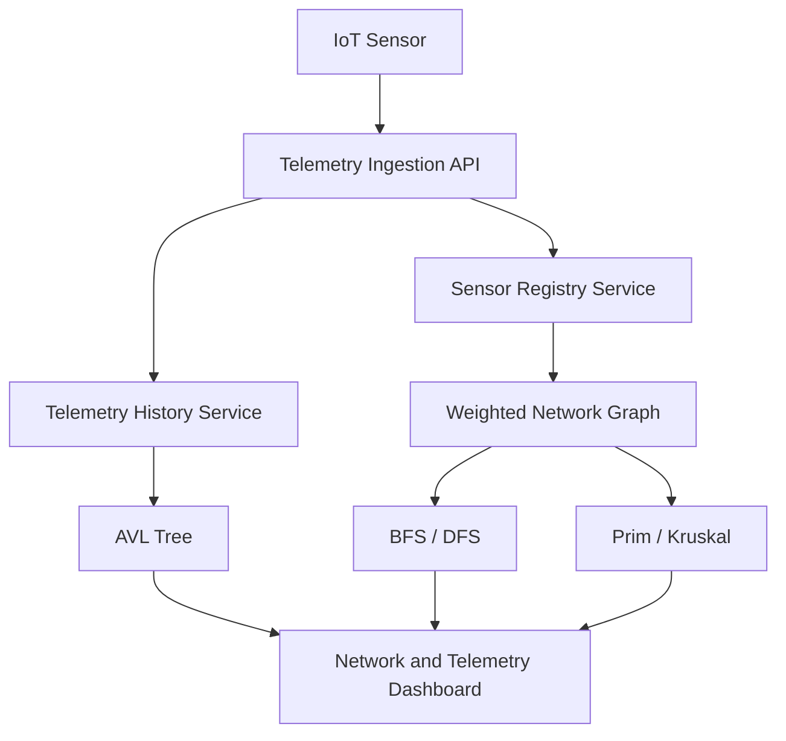

# SmartX-IoT
## Network Topology, Mesh Routing and Historical Telemetry

**Technology Stack:** C# · .NET 10 · ASP.NET Core Web API · Blazor · MudBlazor · AVL Trees · Graph Algorithms

- Author - Shahaan Pillay - ST10438099

---

## Project Overview

SmartX-IoT is an IoT monitoring and management platform designed to simulate and manage distributed sensor networks. The application provides a centralised environment for receiving telemetry, processing device information, managing commands and analysing network connectivity.

The final phase extends the platform with advanced data structures and graph algorithms to support efficient historical telemetry retrieval and intelligent mesh network analysis.

IoT deployments can generate substantial volumes of telemetry from devices such as ESP32 microcontrollers, environmental sensors, smart meters and automated actuators. Processing this information through ordinary collections and repeated linear searches can become inefficient as the volume of historical information increases.

SmartX-IoT addresses this challenge through two major algorithmic components:

- **AVL Tree:** Organises timestamped telemetry readings and supports efficient historical range queries.
- **Weighted Graph:** Represents the relationships between IoT devices and supports network traversal and minimum spanning tree calculations.

These structures provide the foundation for the Network Topology and Mesh Routing functionality.

## System Architecture

The application follows a layered architecture that separates the frontend, API controllers, application services and underlying data structures.

The frontend communicates asynchronously with the ASP.NET Core Web API. Controllers expose application functionality, while dedicated services encapsulate telemetry history management and network graph algorithms.

### High-Level Architecture



### Architectural Responsibilities

**Frontend Layer**

The Blazor interface provides the user-facing dashboards for sensor management, telemetry history and network topology. It communicates with the backend through HTTP API requests and presents retrieved information in a structured interface.

**API Layer**

The ASP.NET Core Web API provides endpoints for accessing telemetry information and network-related functionality. Controllers validate incoming requests and delegate processing to application services.

**Application Services**

The services contain the core business logic.

`TelemetryHistoryService` manages timestamped sensor readings using an AVL tree.

`SensorRegistryService` manages registered sensors, their connections, graph traversal and minimum spanning tree calculations.

**Data Structure Layer**

The AVL tree and weighted graph provide specialised storage and processing mechanisms for the requirements of the final assessment phase.

---

# Historical Telemetry and AVL Trees

## Why an AVL Tree?

An IoT monitoring platform must retain historical readings so that users can investigate previous sensor behaviour, identify anomalies and compare measurements across specific periods.

A conventional unsorted list requires a linear scan to locate readings within a timestamp range. As the number of readings increases, this approach becomes increasingly expensive.

SmartX-IoT uses an **AVL tree**, a self-balancing Binary Search Tree, to organise historical telemetry according to timestamps.

An AVL tree maintains a height difference of no more than one between the left and right subtrees of every node.

This balance condition prevents the tree from degenerating into a linear structure when readings arrive in sorted or highly predictable timestamp order.

The resulting tree maintains logarithmic height, allowing efficient insertion and searching.

## AVL Tree Structure

Each AVL node represents a historical telemetry reading.

The node stores:

- The timestamp associated with the reading.
- The telemetry measurement.
- A sequence value used to distinguish readings with identical timestamps.
- References to its left and right child nodes.
- Its calculated height.

The timestamp and sequence value together establish a unique ordering key. This is important because multiple sensor readings may arrive with the same timestamp.

### AVL Tree Illustration



The tree maintains chronological ordering:

- Earlier timestamps are stored in the left subtree.
- Later timestamps are stored in the right subtree.
- Equal timestamps are distinguished using their sequence values.

The diagram illustrates the ordering concept; the actual tree structure changes dynamically as readings are inserted and balancing rotations are performed.

## Self-Balancing Mechanism

AVL trees use a balance factor to determine whether a node requires rebalancing.

The balance factor is calculated as:

`Balance Factor = Height(Left Subtree) - Height(Right Subtree)`

A valid AVL node has a balance factor of -1, 0 or +1.

When insertion or removal causes an imbalance, the tree performs rotations to restore its properties.

SmartX-IoT supports the four standard AVL rotation cases:

**Left-Left Rotation**

Occurs when a node becomes excessively heavy on its left side because of insertion into the left subtree of its left child.

**Right-Right Rotation**

Occurs when a node becomes excessively heavy on its right side because of insertion into the right subtree of its right child.

**Left-Right Rotation**

Occurs when insertion into the right subtree of the left child causes an imbalance. A double rotation restores the balance.

**Right-Left Rotation**

Occurs when insertion into the left subtree of the right child causes an imbalance. A double rotation restores the balance.

These rotations preserve the Binary Search Tree ordering while keeping the tree height logarithmic.

## Historical Range Queries

The most important application of the AVL tree is retrieving telemetry readings within a specified timestamp interval.

For example, an operator may request all soil moisture readings recorded between 14:00 and 16:00 for a particular sensor.

Instead of scanning every historical reading, the AVL tree uses timestamp comparisons to navigate towards the relevant section of the tree.

The range query follows this approach:

- Nodes with timestamps earlier than the requested start time are excluded from the result.
- Nodes within the requested interval are collected.
- Nodes later than the requested end time are excluded.
- Subtrees that cannot contain matching readings are skipped.

The range boundaries are inclusive, meaning readings recorded exactly at the start or end timestamp are eligible for inclusion.

### Range Query Illustration



This approach avoids unnecessary traversal of irrelevant branches.

The expected complexity of a range query is:

**O(log n + k)**

Where:

- `n` represents the number of readings stored in the tree.
- `k` represents the number of readings returned by the query.

The logarithmic component represents navigation through the balanced tree, while the second component represents the work required to retrieve the matching readings.

This makes the structure particularly useful when an operator requests a relatively small time window from a much larger historical dataset.

## Telemetry History Implementation

The implementation is located in:

`SmartX.Api/Services/TelemetryHistoryService.cs`

The service provides functionality for:

- Adding timestamped telemetry readings.
- Retrieving historical readings.
- Retrieving timestamped readings.
- Querying readings within inclusive timestamp ranges.
- Retrieving the latest readings.
- Generating historical summaries.
- Analysing telemetry trends.
- Removing sensor history.
- Inspecting AVL tree diagnostics.

The service maintains independent history structures for individual sensors, preventing one device's readings from being mixed with another device's history.

A simplified example of using the service is:

```csharp
var historyService = new TelemetryHistoryService();

var sensorId = Guid.NewGuid();

historyService.AddReading(
    sensorId,
    24.5,
    DateTime.UtcNow
);

var start = DateTime.UtcNow.AddHours(-2);
var end = DateTime.UtcNow;

var readings = historyService.GetReadingsBetween(
    sensorId,
    start,
    end
);
```

The example illustrates how a sensor's historical measurements can be inserted and retrieved through the service rather than accessing the underlying tree directly.

The service also exposes tree diagnostics, including tree height, node count, balance status and rotation statistics. These diagnostics help verify that the AVL implementation maintains its self-balancing properties.

## Historical Data Performance

The AVL tree offers predictable performance even when telemetry readings arrive in chronological order.

Without balancing, inserting already sorted timestamps into an ordinary Binary Search Tree can produce a structure resembling a linked list. Searching that structure can degrade to linear time.

AVL balancing prevents this degeneration.

| Operation | Expected complexity |
|---|---|
| Insertion | O(log n) |
| Searching | O(log n) |
| Range query | O(log n + k) |
| Full traversal | O(n) |
| Tree space | O(n) |

The range-query complexity is especially important because it allows the application to retrieve a limited historical interval without processing the entire telemetry dataset.

---

# Network Topology and Mesh Routing

## Modelling an IoT Mesh Network

A mesh network differs from a traditional star network because devices can communicate through neighbouring devices instead of relying exclusively on a direct connection to a central gateway.

This is useful in distributed environments where sensors may be positioned across multiple rooms, agricultural zones or industrial facilities.

For example, a soil moisture sensor may communicate with a nearby ESP32 node, which forwards information through another device until it reaches the central gateway.

SmartX-IoT models this environment using a weighted, undirected graph.

The graph contains:

- **Vertices:** Represent registered IoT sensors and devices.
- **Edges:** Represent wireless connections between devices.
- **Weights:** Represent the cost associated with maintaining or using a connection.

The edge weight can represent an estimated communication energy cost or another defined routing cost.

A lower weight represents a more favourable connection under the selected cost model.

## Graph Architecture

The graph is implemented in:

`SmartX.Api/Services/SensorRegistryService.cs`

The service maintains registered sensors and their connections using an adjacency-based representation.

An adjacency representation stores the neighbours associated with each sensor. This makes it efficient to identify which devices are directly connected to a particular node.

### Example Mesh Network



The edge labels represent illustrative connection weights.

The graph allows the application to analyse connectivity and calculate efficient connection structures across the registered sensors.

## Graph Traversal Algorithms

SmartX-IoT implements Breadth-First Search and Depth-First Search.

These algorithms help investigate network connectivity and identify which sensors are reachable from a particular gateway or starting node.

### Breadth-First Search

Breadth-First Search explores a graph level by level.

It begins at a selected sensor and examines its immediate neighbours before exploring devices further away.

The implementation uses a queue to maintain the order in which vertices are visited.

BFS is useful for:

- Identifying all devices reachable from a gateway.
- Determining the minimum number of unweighted network hops.
- Identifying disconnected sensors.
- Analysing the network's connectivity.

The implementation also provides hop-distance information, allowing the application to identify how many connections separate a sensor from the selected starting node.

Its time complexity is:

**O(V + E)**

Where `V` is the number of vertices and `E` is the number of edges.

### Depth-First Search

Depth-First Search explores one path as far as possible before returning to investigate alternative paths.

It is useful for exploring connected components and investigating the structure of a network.

Its time complexity is also:

**O(V + E)**

Both algorithms prevent repeated visits to the same vertex through visited-node tracking.

## Minimum Spanning Tree Algorithms

A Minimum Spanning Tree is a subset of a connected weighted graph that connects all vertices without creating cycles while minimising the total edge weight.

For an IoT mesh network, this provides a useful mathematical model for selecting a low-cost network connection structure.

SmartX-IoT implements both Prim's and Kruskal's algorithms.

### Prim's Algorithm

Prim's algorithm constructs a minimum spanning tree by starting from a selected vertex and repeatedly adding the lowest-weight edge that connects the existing tree to a new vertex.

The implementation uses a priority queue to efficiently select candidate edges.

The process continues until all reachable vertices have been included.

The implementation also handles disconnected graphs by continuing with additional components, producing a minimum spanning forest.

Its expected complexity in this implementation is:

**O(E log E)**

This is based on priority-queue processing of candidate edges.

### Kruskal's Algorithm

Kruskal's algorithm begins by sorting the graph edges by weight.

It then considers each edge in ascending order, adding an edge only when doing so does not create a cycle.

Cycle detection is performed using a Disjoint Set Union structure.

The implementation uses path compression and union by rank to improve the efficiency of component operations.

Kruskal's algorithm also supports disconnected graphs by producing a minimum spanning forest.

Its overall complexity is:

**O(E log E)**

The sorting operation dominates the algorithm's execution time.

### Prim and Kruskal Comparison

| Feature | Prim's Algorithm | Kruskal's Algorithm |
|---|---|---|
| Starting point | Selected vertex | Lowest-weight edge |
| Main structure | Priority queue | Disjoint Set Union |
| Edge selection | Expands the existing tree | Processes globally sorted edges |
| Cycle handling | Adds only edges reaching new vertices | Uses component detection |
| Disconnected graph | Produces a forest | Produces a forest |
| Expected complexity here | O(E log E) | O(E log E) |

Both algorithms calculate a minimum spanning forest when the network contains disconnected components.

Their results can be compared by examining the total selected edge weight.

An MST is not automatically the shortest-latency route between every sensor and the gateway. It minimises the total selected edge cost across the spanning structure. Actual packet routing and reliability also depend on the network's routing protocol, link availability and chosen edge-weight model.

---

# Integration Between the Data Structures

The AVL tree and graph operate as complementary components of the SmartX-IoT platform.

The graph represents the physical or simulated relationships between devices, while the AVL tree manages the historical telemetry associated with individual sensors.

Together, they allow an operator to investigate both network connectivity and historical device behaviour.

For example, when a sensor becomes disconnected, the graph can identify which devices remain reachable from the gateway. The telemetry history service can then retrieve previous readings from the affected sensor for investigation.

### Combined Processing Workflow



This separation of responsibilities improves maintainability and allows each algorithmic component to be tested independently.

---

# API Integration

The historical telemetry functionality is exposed through the ASP.NET Core API.

The existing telemetry controllers provide endpoints for retrieving historical readings, summaries, trends and timestamp-filtered data.

| Endpoint | Purpose |
|---|---|
| `GET /api/telemetry/history/{sensorId}` | Retrieve historical readings for a sensor |
| `GET /api/telemetry/history/{sensorId}/latest?count=` | Retrieve the latest readings |
| `GET /api/telemetry/history/{sensorId}/range?from=&to=&limit=` | Retrieve readings within a timestamp range |
| `GET /api/telemetry/history/summary` | Retrieve historical telemetry summaries |
| `GET /api/telemetry/history/{sensorId}/trend?count=` | Retrieve sensor trend information |
| `GET /api/telemetry/history/{sensorId}/matrix` | Retrieve historical readings in matrix form |
| `GET /api/telemetry/history/{sensorId}/timestamped` | Retrieve timestamped readings |
| `GET /api/telemetry/history/recent` | Retrieve recent telemetry history |

The graph algorithms are implemented within `SensorRegistryService` and are available to application components through its service methods.

The graph service provides operations for registration, connection management, traversal, hop-distance calculations and minimum spanning tree generation.

---

# Performance and Scalability Considerations

The selected data structures address different performance requirements within an IoT environment.

**AVL Tree Performance**

The AVL tree maintains logarithmic height through rotations. This provides predictable insertion and search performance, even when incoming timestamps are already sorted.

Range queries avoid scanning unrelated historical records, making the approach suitable for retrieving specific time intervals from larger datasets.

**Graph Performance**

The adjacency-based graph representation supports efficient access to the neighbours of a device.

BFS and DFS operate in O(V + E) time, making them appropriate for analysing network connectivity.

Prim's and Kruskal's algorithms calculate minimum spanning forests using priority-queue and sorting-based approaches.

**Concurrency and Data Integrity**

The graph service protects shared registry and connection operations through synchronisation.

The telemetry history service maintains independent per-sensor tree structures and protects modifications to individual histories.

These measures help prevent inconsistent state when multiple operations access the services concurrently.

**Scalability Considerations**

For substantially larger production deployments, the in-memory structures could be complemented by persistent storage, distributed ingestion, network partitioning and asynchronous processing.

The current implementation provides an algorithmic foundation for these future extensions.

---

# Testing and Verification

The project includes automated tests within `SmartX.Tests`.

The historical telemetry tests cover:

- AVL insertion and balancing.
- Left-left, right-right, left-right and right-left rotations.
- Large sequential insertion workloads.
- Duplicate timestamps.
- Inclusive timestamp range boundaries.
- Range limits and invalid ranges.
- Capacity management and historical eviction.
- Concurrent operations.
- AVL diagnostic information.

The graph tests cover:

- Sensor registration and removal.
- Weighted undirected connections.
- Invalid connection weights.
- BFS and DFS traversal.
- Disconnected sensor identification.
- Minimum hop-distance calculations.
- Prim's minimum spanning forest.
- Kruskal's minimum spanning forest.
- Concurrent registry and connection operations.

Run the automated test suite from the solution directory:

```bash
dotnet test SmartX.Tests/SmartX.Tests.csproj
```

To build the complete solution:

```bash
dotnet restore
dotnet build
```

The tests should be executed after changes to either data structure or its integration services to help prevent regressions.

---

# Installation and Execution

## Prerequisites

Ensure the development environment includes:

- .NET 10 SDK.
- Visual Studio 2022 with the appropriate .NET development workload, or another compatible .NET IDE.
- Git.
- A supported web browser.

## Clone the Repository

```bash
git clone https://github.com/shahaanp19/PROG-7312-POE-Part-2.git

cd PROG-7312-POE-Part-2
```

## Restore Dependencies

```bash
dotnet restore
```

## Build the Solution

```bash
dotnet build
```

## Run the Backend API

```bash
dotnet run --project SmartX.Api
```

The API startup output displays the configured listening address. Use that address when accessing the API or configuring the frontend.

## Run the Frontend

Open a separate terminal and execute:

```bash
dotnet run --project SmartX.Web
```

Use the frontend URL displayed in the terminal to access the SmartX-IoT application.

## Run Automated Tests

```bash
dotnet test SmartX.Tests/SmartX.Tests.csproj
```

---

# Future Improvements

Although the current implementation establishes the core tree and graph algorithms, several extensions could improve the platform's suitability for larger IoT deployments.

**Persistent Telemetry Storage**

Integrating a time-series database such as InfluxDB or a suitable cloud data platform would allow historical telemetry to survive application restarts and support longer retention periods.

**Real-Time Communication**

SignalR could provide live dashboard updates when sensors report new readings, change connectivity status or trigger alerts.

**Advanced Mesh Routing**

Future development could incorporate shortest-path algorithms such as Dijkstra's algorithm to calculate minimum-cost routes between individual devices and a gateway.

**Dynamic Network Weights**

Connection weights could be recalculated using measured signal strength, packet loss, transmission energy and link reliability instead of relying exclusively on configured values.

**Cloud Deployment**

Containerisation and deployment through cloud infrastructure could improve scalability and support distributed IoT gateway installations.

**Monitoring and Observability**

Structured logging, application metrics and distributed tracing could provide deeper insight into API performance, telemetry ingestion rates and network behaviour.

---

# Conclusion

SmartX-IoT uses specialised data structures and algorithms to address two important challenges in distributed IoT environments: efficiently retrieving historical telemetry and analysing network connectivity.

The AVL tree provides self-balancing timestamp organisation and efficient range queries, while the weighted graph models sensor relationships and enables connectivity analysis through BFS and DFS.

Prim's and Kruskal's algorithms extend this functionality by calculating minimum spanning forests, providing a mathematical basis for evaluating low-cost mesh connection structures.

By separating these responsibilities into dedicated services and integrating them through the .NET API architecture, the platform establishes a maintainable foundation for further development of an intelligent IoT monitoring and management ecosystem.

The implementation demonstrates the practical application of tree structures, graph theory, algorithmic complexity, concurrency control and API integration within a realistic simulated IoT scenario.
